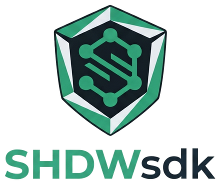

<div align="center">

<a href="https://www.shdwsdk.ai">
  <picture>
    <source media="(prefers-color-scheme: dark)" srcset="https://raw.githubusercontent.com/shdwaibuild/shdwsdk-js/main/.github/assets/logo-dark.png">
    
  </picture>
</a>

### Non-blocking AI carbon telemetry and AI-BOM discovery for OpenAI, Anthropic and Gemini

[](https://www.npmjs.com/package/@shdwsdk/sdk)
[](https://www.npmjs.com/package/@shdwsdk/cli)
[](https://github.com/shdwaibuild/shdwsdk-js/actions/workflows/ci.yml)
[](LICENSE)

[**shdwsdk.ai**](https://www.shdwsdk.ai) · [**Docs**](https://www.shdwsdk.ai/docs) · [**Methodology**](https://www.shdwsdk.ai/docs/scope3-methodology-eu-regions) · [**Python SDK**](https://github.com/shdwaibuild/shdwsdk-python)

</div>

---

This is the open-source client for [SHDWsdk](https://www.shdwsdk.ai). Wrap your AI client once, and every call reports **model IDs and token counts**, never prompts or completions. SHDWsdk turns those reports into Scope 3 emissions figures, an AI Bill of Materials, and EU AI Act / NIST AI RMF documentation your enterprise buyers ask for.

The code is public so your security team can check exactly what leaves your app.

## Install

```bash
npx @shdwsdk/sdk init        # interactive setup: API key, grid region, framework detection
```

or

```bash
npm install @shdwsdk/sdk
```

Works on Node.js 20+, Deno, Bun, Edge runtimes and the browser. The runtime has no dependencies.

## Usage

```ts
import OpenAI from "openai";
import Anthropic from "@anthropic-ai/sdk";
import { ShdwTelemetryClient } from "@shdwsdk/sdk";

const shdw = new ShdwTelemetryClient({
  apiKey: process.env.SHDW_API_KEY!,
  defaultGridRegion: "eu-north-1",          // where your provider serves you from
  defaultWorkloadName: "Support Copilot",   // how this workload appears in your AI-BOM
});

export const openai = shdw.wrapClient(new OpenAI());
export const anthropic = shdw.wrapClient(new Anthropic());
```

Use the wrapped clients exactly as before, including streaming. Google Gemini (`@google/genai`) is wrapped the same way.

### Per-customer emissions statements

Tag calls with **your** customer's account ID (pseudonymous, never an email) to give each customer the AI emissions attributable to their usage:

```ts
const shdw = new ShdwTelemetryClient({
  apiKey: process.env.SHDW_API_KEY!,
  resolveCustomerRef: () => requestContext.get()?.accountId,
});
```

### RAG and vector stores

```ts
const index = shdw.wrapVectorStore(pinecone.index("docs"), {
  sourceUrl: "pinecone://docs",
  embeddingModelId: "text-embedding-3-small",
});
```

### Scan a codebase in CI

```ts
import { scanProjectManifestForAiBom } from "@shdwsdk/sdk/scanner";
```

finds AI SDKs, models and vector databases declared in your manifests, so your AI-BOM covers code that hasn't run in production yet.

## What gets sent

| Sent | Never sent |
|---|---|
| Provider and model ID | Prompts |
| Input / output token counts | Completions |
| Grid region and workload name you configure | API keys for your AI providers |
| Optional one-way prompt fingerprint (SHA-256) | User emails or personal data |
| Delivery counters: delivered, dropped by reason, retried | |
| Optional customer reference you choose | |

## Built to stay out of your way

- **Off the request path.** Events are queued and sent in the background, so your AI calls never wait for telemetry.
- **Fail-silent.** Delivery has a hard 1.5 s timeout and never throws into your code. If SHDWsdk is unreachable, your app doesn't notice.
- **Retries with backoff.** Transient 5xx and 429 responses are retried; `getDeliveryStats()` shows what happened.
- **Visible drop rates.** From 1.8.0 the SDK sends its delivery counters (counts only) about once a minute, so the [developer console](https://www.shdwsdk.ai/docs/developer-console) can show exactly what never arrived. Opt out with `deliveryReports: false`.

## Methodology

The SDK sends model IDs, token counts and your grid region. SHDWsdk computes energy and carbon for every event on the server, using the open [EcoLogits](https://ecologits.ai) model, data center PUE and grid carbon intensity per region, so a modified client can't misreport its numbers and methodology updates apply without upgrading the SDK. Full details: [methodology](https://www.shdwsdk.ai/docs/scope3-methodology-eu-regions).

Want the same estimates locally (in a CLI, a dashboard or a what-if tool)? Install the optional [`@shdwsdk/energy-model`](https://github.com/shdwaibuild/shdwsdk-js/tree/main/packages/energy-model) package.

## Upgrading from 1.x

2.0 removes the client-side energy model from this package. Your telemetry code doesn't change: dashboards, reports and AI-BOMs show the same server-computed numbers as before.

If you called `calculateFootprint`, `estimateInferenceEnergy`, `resolveEnergyModel`, `resolveModelCoefficient`, `MODEL_ENERGY_COEFFICIENTS`, `ENERGY_MODEL_CATALOG` or `ENERGY_METHODOLOGY` directly, install `@shdwsdk/energy-model` and import them from there:

```bash
npm install @shdwsdk/energy-model
```

```ts
import { calculateFootprint } from "@shdwsdk/energy-model";
```

`GRID_REGION_FACTORS` and `resolveGridRegionFactor` stay in `@shdwsdk/sdk`.

## Packages

| Package | Description |
|---|---|
| [`@shdwsdk/sdk`](https://github.com/shdwaibuild/shdwsdk-js/tree/main/packages/sdk) | Telemetry client, AI-BOM compilers (CycloneDX / SPDX), manifest scanner. MIT, zero dependencies |
| [`@shdwsdk/energy-model`](https://github.com/shdwaibuild/shdwsdk-js/tree/main/packages/energy-model) | Optional client-side energy and carbon estimates (EcoLogits methodology) |
| [`@shdwsdk/cli`](https://github.com/shdwaibuild/shdwsdk-js/tree/main/packages/cli) | `shdw-init` setup wizard: writes env vars, generates boilerplate, checks connectivity |

## Development

```bash
npm install
npm run build
npm test
```

## Contributing

Issues and pull requests are welcome; we check them weekly. For security issues, see [SECURITY.md](https://github.com/shdwaibuild/shdwsdk-js/blob/main/SECURITY.md).

## License

[MIT](LICENSE). `@shdwsdk/energy-model` has its own license; see that package.
